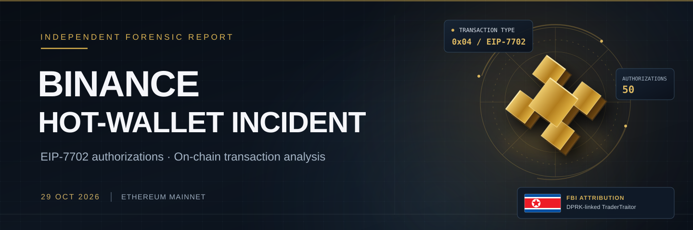
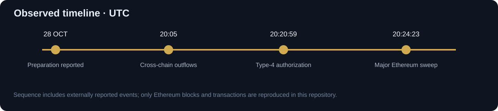
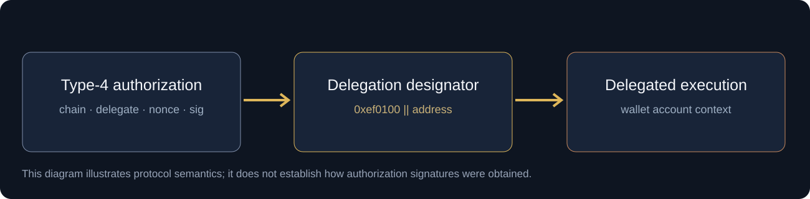
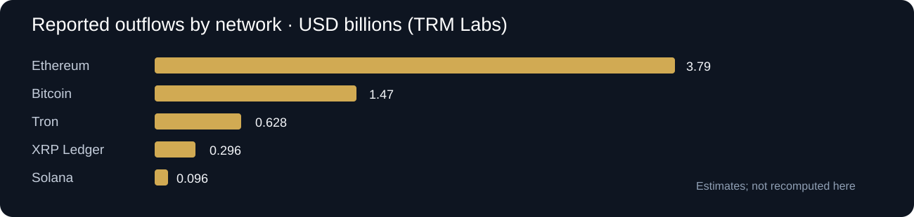

<p align="center"></p>

> **NEW TO BLOCKCHAIN FORENSICS?** Start with the [guided learning path](docs/00-start-here.md). No wallet, exchange account or code download is required to inspect the evidence.


<p align="center">
  <strong>INDEPENDENT ON-CHAIN CASE STUDY</strong> · 29 OCTOBER 2026 · ETHEREUM MAINNET
</p>
<p align="center">
  <a href="docs/00-start-here.md">Start here</a> ·
  <a href="docs/01-incident-report.md">Incident report</a> ·
  <a href="docs/02-evidence-ledger.md">Evidence ledger</a> ·
  <a href="docs/03-eip7702-contract-analysis.md">Contract analysis</a> ·
  <a href="docs/04-reproduction.md">Reproduce results</a> ·
  <a href="docs/05-sources-and-limitations.md">Sources</a> ·
  <a href="site/index.html">Interactive field report</a> ·
  <a href="https://drkasber1-art.github.io/binance-hot-wallet-incident-2026/">Live site (after Pages is enabled)</a>
</p>

---

> **Research snapshot · 31 October 2026 (UTC).** This repository examines publicly observable Ethereum transactions associated with Binance's October 2026 hot-wallet security incident. Its purpose is to reproduce *selected on-chain findings* and explain their relationship to reported internal events. It is **not** an official post-mortem, a complete audit of the reported cross-chain loss, or proof of the initial intrusion vector.

## Case overview

On 29 October 2026, Binance reported unauthorized movements from its hot-wallet infrastructure. Binance estimated the impact at approximately **$6.3 billion**. TRM Labs estimated approximately **$6.36 billion across ten blockchains**, using asset valuations at the time of transfer. Bitquery grouped approximately **$6.3 billion across nine chains**. These numbers are *published estimates with different grouping and valuation methods*, not outputs of this repository's Ethereum-only verifier. [S01][S04][S05]

The most instructive Ethereum artifact is a type-`0x04` transaction containing **50 EIP-7702 authorization tuples**. An effective authorization changed the execution behavior of a Binance-labeled hot wallet to delegate to code at `0x63e842…6fae`. A subsequent externally initiated call drained substantial ETH and ERC-20 balances. The same delegated authority was reportedly used to exercise control associated with a separate smart account. [S05][S06][S08][S11]

**The critical distinction:** public transactions demonstrate *what was authorized and executed*. They do not show whether an employee device was compromised, how the signatures were obtained, whether keys were exposed, or the real-world identity of an operator. Binance identified a compromised DevOps laptop and access to a service container as an **initial hypothesis**, later noting additional compromise points. [S01][S02]

<p align="center"></p>

## Evidence anchors

| Artifact | On-chain reference | What to test |
|:---|:---|:---|
| Binance-labeled hot wallet | [`0x28c6…1d60`](https://etherscan.io/address/0x28c6c06298d514db089934071355e5743bf21d60) | Historical account code and balance |
| Operator / transaction submitter | [`0x7c86…5ca0`](https://etherscan.io/address/0x7c8601d4645b93cea45f71e118a729332e6b5ca0) | Caller/fee payer, **not** verified real-world identity |
| Delegation implementation | [`0x63e8…6fae`](https://etherscan.io/address/0x63e842b054bd624a465454d533c33f573e9c6fae) | Deployment, runtime code and function selectors |
| Main receiving address | [`0x5227…2f8c`](https://etherscan.io/address/0x5227f603c1ee34ce3c06efe6477003bdfccb2f8c) | Recipient flow (address classification from investigators) |
| Type-4 authorization | [`0xad99…298b`](https://etherscan.io/tx/0xad99264d5532ae0dd04b2004eebda05f25657e70dacb764f7ac8d4ccd051298b) | Block **26,300,753** · 20:20:59 UTC · 50 tuples |
| First major sweep | [`0x53bd…e2f3`](https://etherscan.io/tx/0x53bd38b816c23e74134786c29a8c18d792777998a3b9326047b583100e88e2f3) | Block **26,300,770** · 20:24:23 UTC · receipts and event logs |

Full addresses, timestamps and cited observations are in [`data/evidence.json`](data/evidence.json). **Do not equate wallet labels with cryptographic proof of ownership.** [S08][S11]

## Mechanism: where execution authority changed

<p align="center"></p>

1. A set-code transaction (type `0x04`) carried 50 authorization tuples. For EIP-7702, each tuple specifies a chain ID, delegate address, nonce and secp256k1 signature.
2. Verification and nonce checks determine which authorizations take effect. **Fifty valid cryptographic signatures do not imply fifty installed delegations.** [S07][S08]
3. The effective authorization installed a **delegation designator** (`0xef0100 || delegate_address`) in the Binance 14 account code. Subsequent calls to that account executed the delegate's code *in the account's execution context*. [S07]
4. A call to the wallet with selector `0x8a179be4` is associated with a bulk transfer action. A separate reported path via `0x043ff9d2` used the delegated wallet's authority over another smart account. Function labels are reconstructed from published contract analyses and should be independently checked against bytecode/traces. [S06][S11]
5. Binance revoked the affected authorization; investigators observed that the malicious designator was removed. Revocation stops later delegated execution, but does not undo prior finalised transfers. [S02][S06]

**This is not evidence that EIP-7702 itself was broken.** An EIP-compliant authorization can be extremely dangerous when a high-value account's signing or approval boundary is compromised.

## Reproduce selected Ethereum evidence (optional)

Transactions can be inspected using the links above without downloading anything. To execute the **read-only** Python verifier:

```bash
python -m pip install -e .
python -m unittest discover -s tests -v
python -m hotwallet_forensics.cli facts
export ETH_RPC_URL="https://YOUR_ETHEREUM_MAINNET_RPC"
python -m hotwallet_forensics.cli verify
```

PowerShell: `$env:ETH_RPC_URL="https://YOUR_ETHEREUM_MAINNET_RPC"`.

The current verifier reads the transaction and receipt fields; it does **not** recover signatures, trace all token transfers or independently value losses across networks. See the [reproduction guide](docs/04-reproduction.md).

## Repository map

```text
README.md             Case overview, evidence links and reader index
docs/00-start-here.md Guided beginner walkthrough
docs/01-incident-report.md  Chronology and reported incident scenario
docs/02-evidence-ledger.md  Transaction evidence and confidence boundaries
docs/03-eip7702-contract-analysis.md Protocol explanation
docs/04-reproduction.md Optional code verification
docs/05-sources-and-limitations.md Canonical citations and caveats
data/                 Evidence and source records
assets/               Original SVG figures
site/                 Interactive dark forensic website
src/                  Read-only Ethereum RPC verifier
tests/                Offline unit tests
```

## Findings by evidence class

| Statement | Classification | Confidence boundary |
|:---|:---|:---|
| Type-4 authorization and subsequent sweep transactions occurred | **Directly verifiable on-chain** | Verify hash, receipt, block and historical code using RPC |
| A set of 50 authorization tuples was submitted | **Directly verifiable on-chain** | Count authorization list; distinguish signature validity from execution |
| A DevOps laptop/service-container compromise was the entry point | **Binance preliminary hypothesis** | Cannot be established from public ledger data |
| Approximately $6.3B–$6.36B was lost across chains | **Operator disclosure / third-party valuation** | Varies by network grouping, token pricing and snapshot |
| TraderTraitor conducted the theft | **FBI attribution** | Off-chain evidence and attribution methods are not fully public |
| 90% of stolen-token balances were replenished by 31 October | **Operator statement reported by Reuters** | Replenishment does not mean stolen coins were recovered |

Read [the evidence standards and unresolved questions](docs/05-sources-and-limitations.md) before reusing any finding.

## Additional material

<p align="center"></p>

- [01 — Incident report](docs/01-incident-report.md): context, chronological reconstruction, attack scenario, observed vs inferred events.
- [02 — Evidence ledger](docs/02-evidence-ledger.md): primary identifiers, evidence handling and claim-to-source matrix.
- [03 — EIP-7702 / contract analysis](docs/03-eip7702-contract-analysis.md): signature domain, account code, selectors, smart-account control and defensive boundaries.
- [04 — Reproduction guide](docs/04-reproduction.md): RPC queries, verifier output, validation checklist and test requirements.
- [05 — Sources and limitations](docs/05-sources-and-limitations.md): source register, classification policy and unresolved questions.
- [06 — Defensive engineering](docs/06-defensive-engineering.md): signing infrastructure controls and detection opportunities.

## Research integrity

No internal Binance telemetry, seized devices, proprietary blockchain intelligence or privileged attribution feeds were used. No live RPC verification has yet been executed in this publication. Historical wallet addresses are included solely as public transaction identifiers. A source-backed statement is not automatically an independently reproduced finding; those categories remain separate throughout the repository.

Data and analysis are fixed to **31 October 2026 UTC**. Later discoveries should appear as dated revisions, not silent retroactive edits. Refer to [CONTRIBUTING.md](CONTRIBUTING.md) for correction standards.

---

<sub>**References** — [S01](https://www.binance.com/en/support/announcement/detail/c5a8729a97ac486d963784d96c5642d7) · [S02](https://www.binance.bh/en-GB/support/announcement/security-incident-update-2-2026-10-30-d3306d9dca5243548c813b605e1d1751) · [S03](https://www.fbi.gov/investigate/cyber/alerts/2026/north-korea-responsible-for-6-billion-binance-attack) · [S04](https://www.trmlabs.com/resources/blog/north-korea-steals-usd-6-36-billion-from-binance-in-the-largest-hack-in-history) · [S05](https://bitquery.io/investigations/binance-hack) · [S06](https://hacken.io/insights/binance-hack/) · [S07](https://eips.ethereum.org/EIPS/eip-7702) · [S08](https://media.gcsa.com/en-US/news-3730400) · [S09](https://www.reuters.com/legal/government/binance-says-90-stolen-assets-replenished-2026-10-31/) · [S11](https://chainward.ai/decodes/binance-7702-delegation). Complete bibliographic details: [data/sources.json](data/sources.json).</sub>


